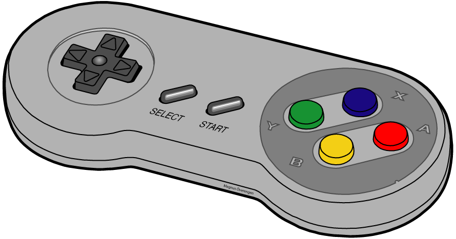

# SNESctl (`sˈnɛʃtəl`)




Retrofit old SNES controllers with Bluetooth connectivity using the low power NRF52840 microcontroller.

This project uses the NRF52840 based [nice!nano] with the Adafruit
Bluefruit library for Bluetooth communication.

## Features
- Low power consumption with the NRF52840 microcontroller.
- Turns controller off between readings to save battery life.
- Compatible with most classic SNES controller replacements or knock offs.

## Hardware
The [nice!nano] has a built-in battery charger and can be powered by a single cell Li-ion battery. The SNES
controller is connected to the [nice!nano] using the 5 pin connector on the back of the controller. The 
[nice!nano] is quite sophisticated and the pins (of the employed SPI hardware) are almost freely configurable.
The controller can be connected to the microcontroller however it is convenient.

More details on the [nice!nano] and alternatives can be found in this repo: [nrfmicro].

## Software
The software is written in C++ using the Arduino framework via PlatformIO, with the 
[Nicenano-NRF52-Supermini-PlatformIO-Support](https://github.com/ICantMakeThings/Nicenano-NRF52-Supermini-PlatformIO-Support).

```bash
pio run -t upload   # will build and flash the code
```

## Documentation
For pinouts and timing diagrams please have a look at the [docs](./docs).

> NOTE: There are two switches to debug, namely `DEBUG_HID_REPORT` and `DEBUG_BATTERY_REPORT`. Please
> have a look at the [platformio.ini](./platformio.ini) for more details.

[nice!nano]: https://nicekeyboards.com/nice-nano/
[nrfmicro]: https://github.com/joric/nrfmicro/wiki/Alternatives
