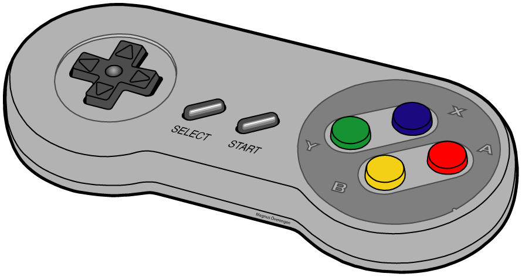

# SNESctl (`sˈnɛʃtəl`)
[](./LICENSE)
[](https://github.com/milkpirate/snesctl/actions/workflows/build.yml)



Retrofit old SNES controllers with Bluetooth connectivity using the low power NRF52840 microcontroller.

This project uses the NRF52840 based [nice!nano] with the Adafruit
Bluefruit library for Bluetooth communication.

## Features
- Low power consumption with the NRF52840 microcontroller.
- Turns the controller off between readings to save battery life.
- Powers down completely if no connection is made within 2 minutes, so a forgotten controller does not drain
  the battery.
- Reports the battery level via the standard BLE battery service.
- Compatible with most classic SNES controllers, replacements and knock-offs.

## Hardware
The [nice!nano] has a built-in battery charger and can be powered by a single cell Li-ion battery. The SNES
controller is connected to the [nice!nano] using the 5 wires of the controller cable. The [nice!nano] is quite
sophisticated and the pins (of the employed SPI hardware) are almost freely configurable, so the controller can be
connected to the microcontroller however it is convenient.

More details on the [nice!nano] and alternatives can be found in this repo: [nrfmicro].

### Parts
- [nice!nano] v2 (or a compatible clone, e.g. the "SuperMini nRF52840"). The v1 is not supported as is: its
  external VCC cutoff (`P0.13`) has the inverted polarity and the battery voltage is measured differently.
- SNES controller (original or knock-off)
- single cell LiPo battery that fits into the controller housing
- power switch between the battery and the `BATTERY+` pin (to power cycle the controller)

> NOTE: The charge current of the [nice!nano] is 100 mA by default. Only bridge the `BOOST` jumper (500 mA) if the
> battery is larger than 500 mAh.

### Wiring
The pins are configured in [`src/main.cpp`](./src/main.cpp) (`Config::Pins`). The wire colors are the ones of
the controller used during development and differ between manufacturers, so check the controller's PCB.

| SNES controller | nice!nano pin | Wire color (example) | Notes                                                   |
|-----------------|---------------|----------------------|---------------------------------------------------------|
| VCC             | `3.3V`        | white                | switched on/off via `P0.13` (external VCC cutoff)       |
| Clock           | `P0.31`       | blue                 | SPI SCK                                                 |
| Latch           | `P0.29`       | yellow               |                                                         |
| Data            | `P0.02`       | red                  | SPI MISO                                                |
| GND             | `P1.15`       | brown                | driven low while reading, floating in between           |

`P1.13` is claimed as SPI MOSI by the firmware, but unused (configured as input), so leave it unconnected.

See the [docs](./docs) for the pinouts of the [nice!nano] ([v2](./docs/pinout-v2.png), [v1](./docs/pinout.png)).

### Button mapping
The controller shows up as a standard BLE HID gamepad:

| SNES button | HID gamepad |
|-------------|-------------|
| B           | button 0    |
| Y           | button 1    |
| Start       | button 2    |
| Select      | button 3    |
| A           | button 4    |
| X           | button 5    |
| L           | button 6    |
| R           | button 7    |
| D-pad       | X/Y axis    |

## Usage
1. Switch the controller on, it starts advertising as `SNESctl`.
2. Pair it in the Bluetooth settings of your phone/laptop/console within 2 minutes.
3. Open any application that accepts gamepad input.

If no connection is made within 2 minutes (also after a disconnect), the controller powers down completely
(nRF52 System OFF). Power cycle it with the switch (or plug in USB) to start over.

## Software
The software is written in C++ using Adafruit's Arduino framework [Adafruit_nRF52_Arduino] via PlatformIO. The
board definition and pinout (variant) of the nice!nano are downloaded from
[Nicenano-NRF52-Supermini-PlatformIO-Support] by `task setup` (pinned to a commit, updated by Renovate), so
nothing has to be installed into PlatformIO manually.

### Requirements
- [`task`](https://taskfile.dev/docs/installation) - modern `make` alternative for building and running tasks.
- [`uv`](https://docs.astral.sh/uv/getting-started/installation/) - modern Python environment and package manager.
- a host C++ compiler (e.g. `gcc`), for running the unit tests only.

### Building and flashing
```bash
task setup    # installs PlatformIO, the required platforms, toolchains, frameworks and the nice!nano board
task run      # builds the firmware (.hex, .zip and .uf2)
task upload   # builds and flashes the firmware to the device via USB
```

Alternatively, flash the `firmware.uf2` (from `.pio/build/nicenano/` or the artifacts of the
[build pipeline](https://github.com/milkpirate/snesctl/actions/workflows/build.yml)) by drag and drop: double tap
the reset button of the [nice!nano], so it shows up as USB drive, and copy the file onto it.

The firmware revision (`git describe`) is reported via the BLE device information service.

### Other tasks
```bash
task test       # runs the unit tests (Catch2) on the host
task monitor    # opens the serial monitor
task debug      # builds a debug firmware and starts a GDB session (needs a J-Link)
task clean      # removes the build artifacts
task clean:all  # removes everything generated, incl. PlatformIO and the Python environment
```

Pass additional PlatformIO arguments after `--`, e.g. `task upload -- --upload-port COM5`.

## Documentation
For pinouts and timing diagrams please have a look at the [docs](./docs).

> NOTE: There are some debug switches, namely `WAIT_FOR_SERIAL`, `DEBUG_HID_REPORT` and `DEBUG_BATTERY_REPORT`.
> Please have a look at the [`platformio.ini`] for more details.

## Credits
_Image [SNES Controller](https://commons.wikimedia.org/wiki/File:SNES-controller.png) by Magnus Överengen, [CC0](https://creativecommons.org/publicdomain/zero/1.0/deed.en), via Wikimedia Commons_

_nice!nano board definition and variant from [Nicenano-NRF52-Supermini-PlatformIO-Support]_

[`platformio.ini`]: ./platformio.ini

[nice!nano]: https://nicekeyboards.com/nice-nano/
[nrfmicro]: https://github.com/joric/nrfmicro/wiki/Alternatives
[Adafruit_nRF52_Arduino]: https://github.com/adafruit/Adafruit_nRF52_Arduino
[Nicenano-NRF52-Supermini-PlatformIO-Support]: https://github.com/ICantMakeThings/Nicenano-NRF52-Supermini-PlatformIO-Support
